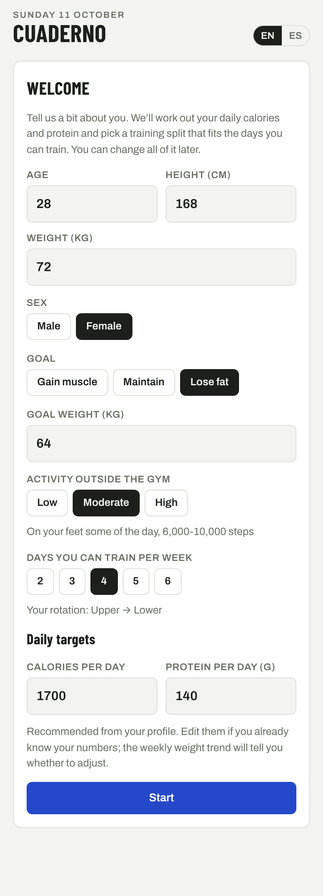
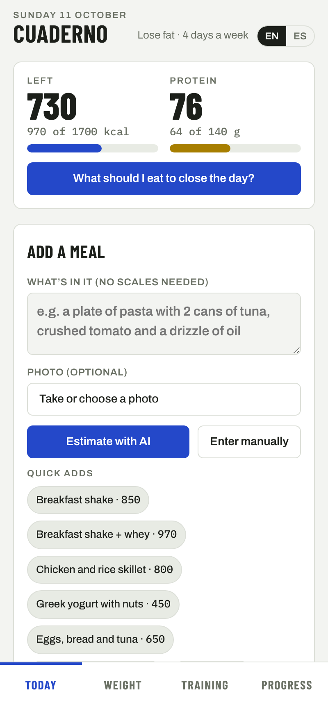
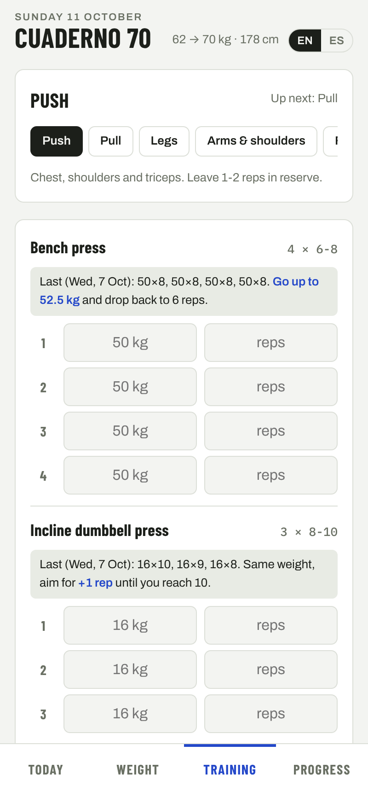
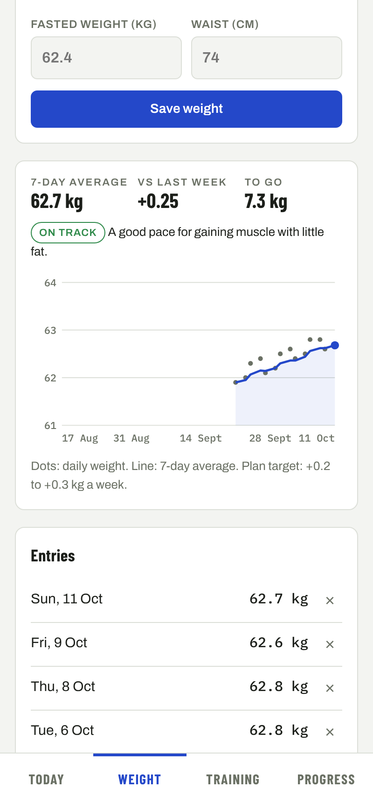

# Cuaderno

An installable training and nutrition log for anyone who wants to gain muscle, lose fat or hold their weight. Set up a short profile and the app works out your daily calories and protein, picks a training split for the days you can train, and tracks your progress: log your morning weight, follow your routine with automatic progression hints, estimate meals from a photo or a plain description instead of weighing food, and get a weekly AI review of how it is going.

Available in English and Spanish. Works offline and installs to the home screen on Android and iOS.

**Live demo:** https://flaviofersu-pixel.github.io/cuaderno-70/

<p>
  
  
  
  
</p>

_Screenshots use sample data._

## Features

- **Personal plan.** A first-run profile (sex, age, height, weight, goal, activity and training days) sets daily calories with the Mifflin-St Jeor equation, protein per kg of body weight and a healthy weekly weight-change range for your goal. Everything can be edited later.
- **Training that fits your week.** Pick 2 to 6 days and get a matching rotation: full body, upper/lower, or push/pull/legs variations.
- **Daily budget.** Calories and protein left for the day, against your targets.
- **Meals without a scale.** Describe a meal ("a plate of pasta with 2 cans of tuna and some oil"), add a photo, or both. Claude estimates calories and macros per ingredient, says how confident it is, and you confirm or edit before saving. Quick-add buttons cover a few common meals.
- **"What should I eat?"** Three concrete options that close the remaining calories and protein with common, quick foods.
- **Weight trend.** Daily weigh-ins, a 7-day rolling average and a pace check against your goal's weekly range, with a concrete calorie adjustment when you drift out of it.
- **Double progression.** Each exercise shows last session's sets and tells you whether to add a rep or move up in weight (2.5 kg on compound lifts, 1 kg on isolation work). Unfinished sessions survive closing the app.
- **Weekly check-in and AI review.** A weekly checklist is computed from your logs, and Claude writes a short review with concrete adjustments. Reviews are kept so you can compare weeks.
- **Backup.** Export and restore all logs as JSON. The API key is never included.

## Tech stack

| Area    | Choice                                                                                                            |
| ------- | ----------------------------------------------------------------------------------------------------------------- |
| UI      | React 19, TypeScript (strict), plain CSS with design tokens and light/dark themes                                 |
| Build   | Vite, `vite-plugin-pwa` (Workbox service worker, web app manifest)                                                |
| Storage | IndexedDB through Dexie, with live queries driving the UI                                                         |
| AI      | Anthropic TypeScript SDK, structured outputs validated with Zod, streaming for long answers                       |
| Quality | ESLint (`typescript-eslint` strict type-checked, React Hooks), Prettier, Vitest                                   |
| CI/CD   | GitHub Actions: type check, lint, format check, tests and build on every push; deploy to GitHub Pages from `main` |

## Architecture

```
src/
├── data/        Routines, splits per training days, exercises and meal presets
├── domain/      Pure logic: targets, dates, weight trend, progression, nutrition, weekly check-in (unit tested)
├── db/          Dexie schema, data-layer helpers and JSON backup
├── services/
│   ├── ai/      Anthropic client, Zod schemas and typed errors, lazy-loaded on first use
│   └── prompts.ts
├── i18n/        English and Spanish messages with a shared, type-checked shape
├── features/    One folder per tab (today, weight, training, progress) plus the profile form
├── components/  Small shared UI pieces
└── hooks/       Live data hooks
```

A few decisions worth calling out:

- **Logic is separate from UI.** Everything that decides something (calorie targets, pace, when to add weight, the weekly checklist) lives in `src/domain` as pure functions with tests. Components only render and handle input.
- **No backend.** Data stays on the device in IndexedDB. The AI features call the Anthropic API directly from the browser with a key the user provides, stored only on their device. This keeps the app free to host on GitHub Pages; the trade-off is that it suits a personal tool rather than a multi-user product.
- **The AI code is loaded on demand.** The SDK and Zod are split into a separate chunk that only downloads when an AI feature is first used.
- **Structured outputs.** Meal estimates and suggestions are requested as JSON matching a Zod schema, so the UI never parses free text. Model output rendered as Markdown is turned into React elements, never injected as HTML.
- **Translations are typed.** The Spanish messages must match the English shape at compile time, and a test checks that no key is missing or empty. The AI answers in the selected language.
- **Stable IDs over display names.** Workouts store exercise IDs, so switching language never breaks history or progression.

## Getting started

Requires Node.js 22 or later.

```bash
npm install
npm run dev
```

Open the app and fill in the profile. The AI features work in two ways:

- **With an API key:** go to **Progress → AI** and paste an Anthropic API key from [platform.claude.com](https://platform.claude.com/settings/keys). Answers appear inside the app.
- **Without a key:** each AI feature prepares the question for you to copy into your own Claude app (a Claude Pro plan works), then you paste the reply back. Structured replies are requested as JSON and validated with the same Zod schemas.

### Scripts

| Command           | What it does                                              |
| ----------------- | --------------------------------------------------------- |
| `npm run dev`     | Start the dev server                                      |
| `npm run build`   | Type check and build for production                       |
| `npm run preview` | Serve the production build locally                        |
| `npm test`        | Run the unit tests once                                   |
| `npm run lint`    | Run ESLint                                                |
| `npm run format`  | Format with Prettier                                      |
| `npm run check`   | Type check, lint, format check and tests, as CI runs them |

## Installing on a phone

Open the live demo in the phone's browser, then:

- **Android (Chrome):** menu → **Install app**.
- **iPhone (Safari):** Share → **Add to Home Screen**.

## License

[MIT](LICENSE)
